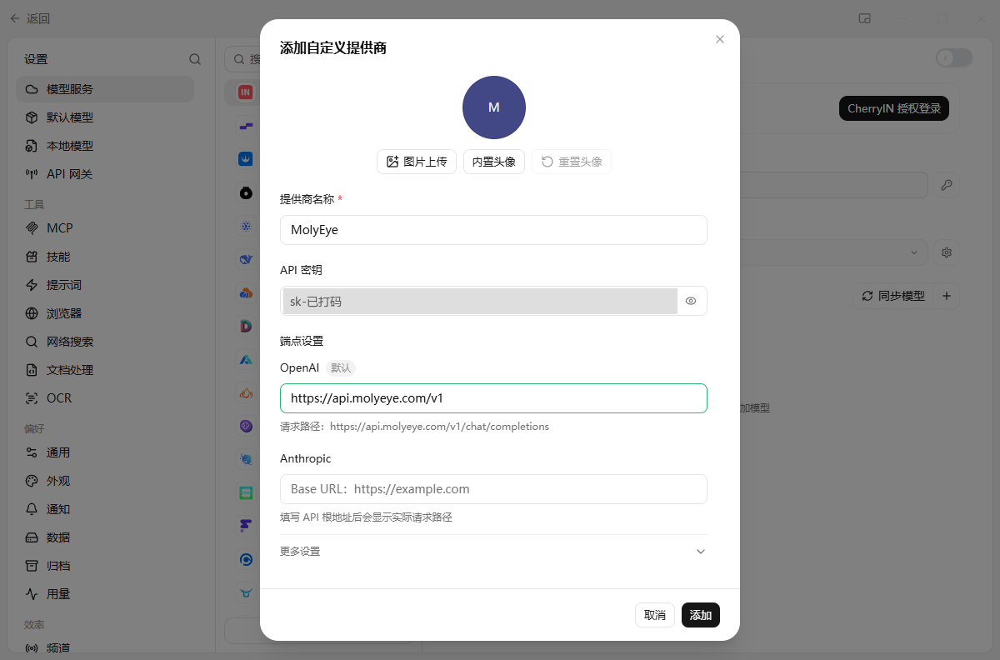
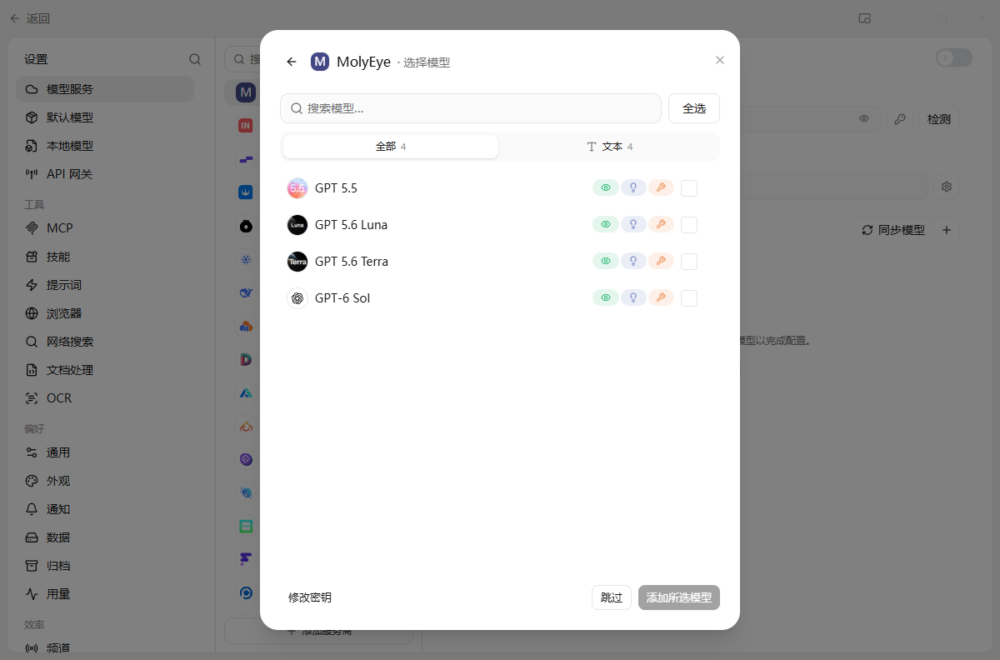
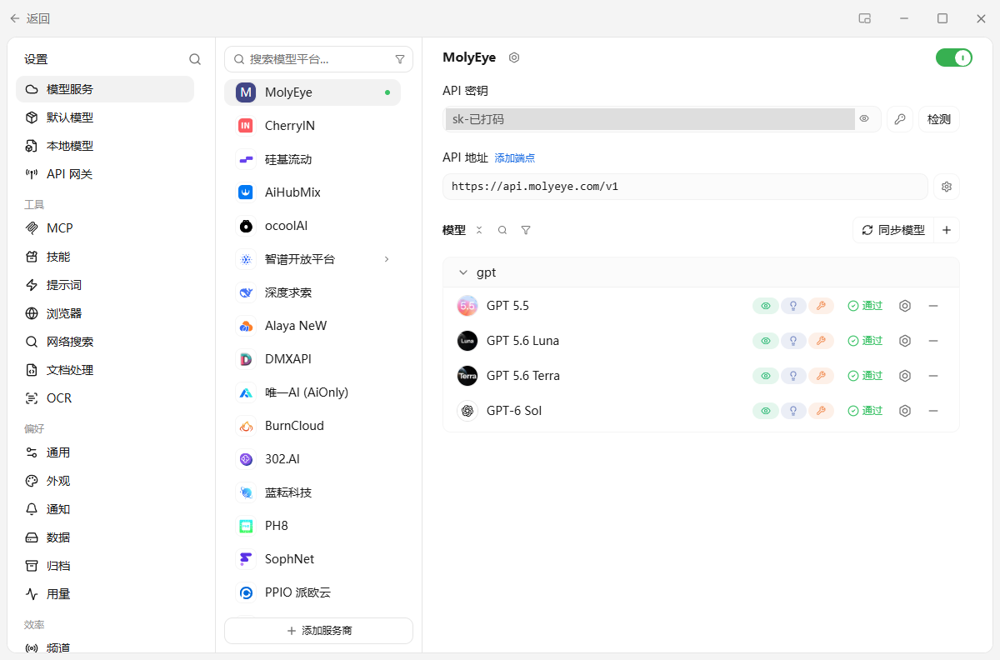
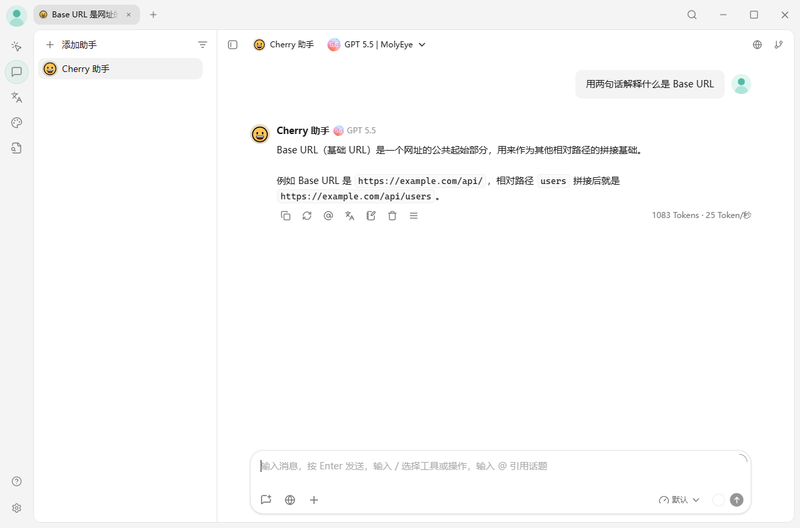

# Cherry Studio 接入自定义 API：添加一个服务商就能聊

> 最后实测：2026-10-13 · Cherry Studio 2.1.4（Windows 便携版） · 预计用时 5 分钟

[← 返回目录](../../README.md)

> [!NOTE]
> 本文用 [MolyEye](https://molyeye.com/?ref=github) 演示，新账号注册送 $0.3 体验额度。还没有 Key 的先看 [快速开始](../basics/quickstart.md)。

**一句话：** 设置 → 模型服务 → 添加服务商，OpenAI 那栏填 `https://api.molyeye.com/v1`，粘贴 Key，添加后勾选模型，回到对话页把模型切过去。

| 填什么 | 值 |
|---|---|
| 提供商名称 | 随便起，例如 `MolyEye` |
| API 密钥 | 控制台创建的 `sk-` 开头的一串 |
| 端点设置 → OpenAI | `https://api.molyeye.com/v1` |
| 模型 | 添加后自动拉取，勾选要用的，例如 `gpt-5.5` |

## 1. 前提

- Cherry Studio，官网或 GitHub Releases 下载，安装版和便携版都行
- 一把 API Key（控制台 → API 密钥）

## 2. 添加服务商

1. 点左下角齿轮进入设置，左栏选 **模型服务**。
2. 服务商列表拉到底，点 **添加服务商**。
3. 弹出「添加自定义提供商」，按上表填三处：名称、API 密钥、端点设置里的 **OpenAI** 一栏。下面另一栏不用管，留空。

填完 Base URL，输入框下面会显示 **请求路径**，确认是 `https://api.molyeye.com/v1/chat/completions` 再点 **添加**。

> 实测 2.1.4 里，写 `https://api.molyeye.com` 或 `https://api.molyeye.com/v1` 都会拼成同一个请求路径，Cherry 会自己补 `/v1`。但末尾别加 `#`：加了它就不再补 `/v1`，请求路径变成 `https://api.molyeye.com/chat/completions`，这个地址不存在，返回 404。

## 3. 选模型

点添加后会直接进入「选择模型」，列表是从 `/v1/models` 拉下来的，就是这把 Key 能用的模型。点 **全选** 或只勾需要的，再点 **添加所选模型**。

接着它会自动跑一遍「检测并启用」：添加所选模型、验证其中一个模型、启用服务商，三个都打勾就点 **完成**。服务商右上角的开关会变成绿色。

## 4. 检测全部模型

想确认每个模型都能用：在服务商页面点 API 密钥旁边的 **检测** → **检测所有模型** → **开始**。

实测第一次检测 `gpt-5.5` 显示「失败」，点开是 `Check model timeout`。原因是检测默认超时 15 秒，gpt-5.5 这类推理模型会先思考，回一个字也可能要十几秒。把弹窗里的 **超时** 改成 60 秒再检测，4 个模型全部通过。这个超时只影响检测按钮，不影响正常聊天。

## 5. 开始对话

回到对话页，看顶部的模型下拉框。新装的 Cherry 默认选的是它自带的 `Qwen | CherryAI`，不切换的话消息不会走你的 Key。点开下拉框，在你起的服务商名字下面选模型，例如 `GPT 5.5`，顶部显示成 `GPT 5.5 | MolyEye` 就对了。

发一句试试：

回答下方会显示本次的 token 数和速度。控制台 **使用日志** 里能看到这一笔，Cherry 默认走流式输出。

想以后新建的对话都用这个模型：设置 → **默认模型**，把「默认助手模型」换成它。同一页的「快速模型」（给对话起标题用）和「翻译模型」默认也是 `Qwen | CherryAI`，想统一就一起换掉。

## 6. 常见问题

以下均为 2026-10-13 实测。

| 现象 | 原因和处理 |
|---|---|
| 检测显示「失败」，点开是 `Check model timeout` | 推理模型响应慢，超过了检测默认的 15 秒。超时改成 60 秒再测，或者直接去对话里发一句 |
| 选择模型页提示 `拉取模型失败。 API 密钥无效，请检查后重新配置` | Key 没复制完整或多了空格。点左下角「修改密钥」重新粘贴 |
| 发消息没扣你的余额，日志里也没有记录 | 顶部模型还是 `Qwen \| CherryAI`，没切到你的服务商 |
| 404 | 请求路径不对。看服务商页面的 API 地址，末尾不要有 `#`，也别写成 `/v1/v1` |
| 401 / 模型不存在 / 429 | 和软件无关，见 [通用排错手册](../basics/troubleshooting.md) |

## 下一步

- [Cline 配置](../coding-tools/cline.md)
- [沉浸式翻译配置](./immersive-translate.md)
- [通用排错手册](../basics/troubleshooting.md)
