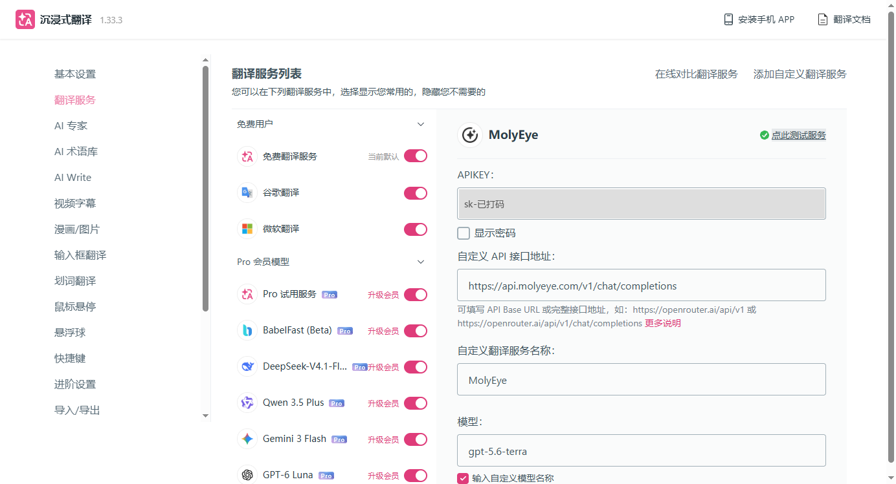
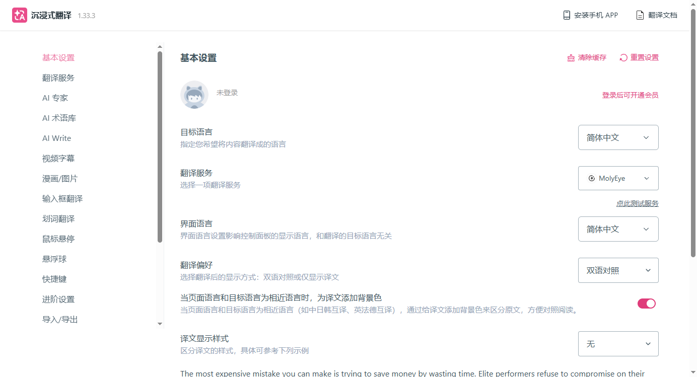
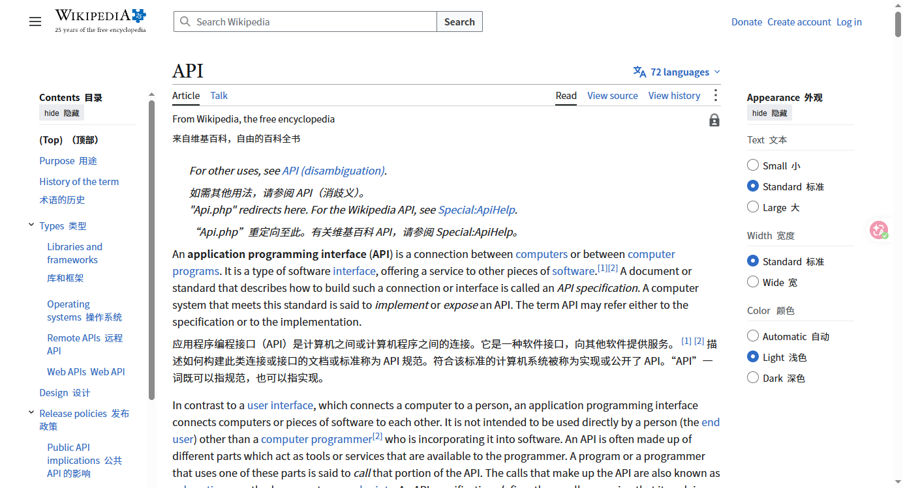

# 沉浸式翻译接入自定义 API：用自己的 Key 翻网页

> 最后实测：2026-10-13 · 沉浸式翻译 1.33.3（Chrome 扩展） · Chrome 148 · 预计用时 5 分钟

[← 返回目录](../../README.md)

> [!NOTE]
> 本文用 [MolyEye](https://molyeye.com/?ref=github) 演示，新账号注册送 $0.3 体验额度。还没有 Key 的先看 [快速开始](../basics/quickstart.md)。

**一句话：** 设置 → 翻译服务 → 添加自定义翻译服务 → 自定义AI，填 APIKEY、接口地址 `https://api.molyeye.com/v1/chat/completions`，勾「输入自定义模型名称」填模型 ID，再到基本设置里把翻译服务切过去。

| 填什么 | 值 |
|---|---|
| APIKEY | 控制台创建的 `sk-` 开头的一串 |
| 自定义 API 接口地址 | `https://api.molyeye.com/v1/chat/completions` |
| 自定义翻译服务名称 | 随便起，例如 `MolyEye` |
| 模型 | 勾「输入自定义模型名称」，填例如 `gpt-5.6-terra` |

## 1. 前提

- Chrome 或 Edge，从浏览器的扩展商店装好「沉浸式翻译」
- 一把 API Key（控制台 → API 密钥）

## 2. 添加自定义翻译服务

1. 打开沉浸式翻译的设置页：工具栏上的扩展图标右键 → **选项**。
2. 左栏点 **翻译服务**，右上角点 **添加自定义翻译服务**。
3. 先弹出「使用须知」，要在输入框里手打 `我已知晓并同意` 才能点确定。
4. 服务列表里选第一个 **自定义AI**。

## 3. 填配置

右侧出现「自定义AI 1」的设置，按上表填：

两处默认值一定要改：

- **自定义 API 接口地址** 默认是别家的地址，整个换掉。实测 1.33.3 里填完整地址 `https://api.molyeye.com/v1/chat/completions`、只填 `https://api.molyeye.com/v1`、只填 `https://api.molyeye.com` 三种都能通。
- **模型** 默认是 `gpt-4o-mini`。先勾下面的 **输入自定义模型名称**，模型框才能手动输入，再填你要用的模型 ID。

这里不用点保存，改完自动保存，页面顶部会闪一下「保存成功」。

填完点右上角 **点此测试服务**，出现绿色对勾就通了。

> 实测第一次测试报 `403: 这个 API Key 无权使用模型 gpt-4o-mini`：刚填完模型名、输入框还没失去焦点就点了测试，新值还没保存，测试用的仍是默认的 `gpt-4o-mini`。报错里看到 `gpt-4o-mini` 就说明模型没改成功，点一下别处让输入框失去焦点再测。

## 4. 设为默认翻译服务

左栏回到 **基本设置**，把 **翻译服务** 下拉框换成你刚起的名字：

## 5. 翻译网页

打开任意英文网页，按 `Alt+A`，或点页面右侧的粉色悬浮球。译文会以双语对照的形式插在原文下面：

控制台 **使用日志** 里能看到一条条翻译请求。沉浸式翻译会把页面切成很多段并发去翻，实测翻这个页面的第一屏就发了 10 次请求，每次几百 token。所以：

- 选响应快、单价低的模型，翻网页用不上最强的推理模型。
- 设置里「每秒最大请求数」默认 5。遇到 429 就把它调低。

## 6. 常见问题

以下均为 2026-10-13 实测。

| 现象 | 原因和处理 |
|---|---|
| 测试报错里出现 `gpt-4o-mini` | 模型还是默认值。勾「输入自定义模型名称」后重新填，失去焦点后再测 |
| 改了地址或模型，测试还是绿勾，但使用日志里没有新记录 | 沉浸式翻译会缓存译文，同一段测试文字第二次不会真的发请求。基本设置右上角 **清除缓存** 后再测 |
| 网页没翻译，还是原来的免费服务在翻 | 基本设置里的「翻译服务」没切到你的自定义服务 |
| 译文出得很慢 | 换一个响应快的模型试试；请求排队太多时也可以调低每秒最大请求数 |
| 401 / 模型不存在 / 429 | 和扩展无关，见 [通用排错手册](../basics/troubleshooting.md) |

## 下一步

- [Cherry Studio 配置](./cherry-studio.md)
- [Cline 配置](../coding-tools/cline.md)
- [通用排错手册](../basics/troubleshooting.md)
