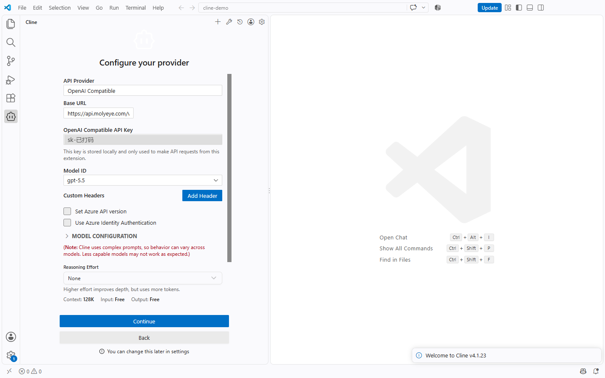
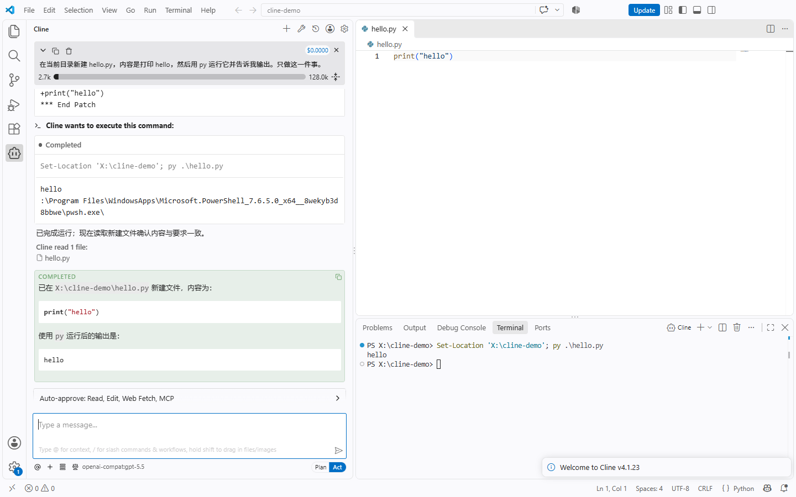

# Cline 接入自定义 API：OpenAI Compatible 三个框

> 最后实测：2026-10-13 · VS Code 1.140.0 · Cline 4.1.23 · Windows 10 · 预计用时 10 分钟

[← 返回目录](../../README.md)

> [!NOTE]
> 本文用 [MolyEye](https://molyeye.com/?ref=github) 演示，新账号注册送 $0.3 体验额度。还没有 Key 的先看 [快速开始](../basics/quickstart.md)。

**一句话：** Cline 设置里 API Provider 选 **OpenAI Compatible**，Base URL 填 `https://api.molyeye.com/v1`，粘贴 Key，Model ID 从下拉框里选，Cline 就会用这个模型读写你的项目。

| 填什么 | 值 |
|---|---|
| API Provider | `OpenAI Compatible` |
| Base URL | `https://api.molyeye.com/v1` |
| OpenAI Compatible API Key | 控制台创建的 `sk-` 开头的一串 |
| Model ID | 例如 `gpt-5.5` |

## 1. 前提

- VS Code
- 一把 API Key（控制台 → API 密钥）

## 2. 安装 Cline

VS Code 左侧扩展面板搜 `Cline`，装发布者为 `saoudrizwan` 的那个。装好后左侧活动栏会多一个机器人图标。

> 用 VS Code 打开文件夹时，如果问你是否信任这个文件夹的作者，选信任。实测在受限模式（左下角显示 `Restricted Mode`）下，左侧根本不出现 Cline 图标。已经点了不信任的，点左下角 `Restricted Mode` → **Trust** 就行。

## 3. 填 API 配置

第一次点开 Cline，会问 `How will you use Cline?`，选 **Bring my own API key** → **Continue**，进入 `Configure your provider`：

1. **API Provider**：点开后输入 `OpenAI Compatible` 搜索并选中。
2. **Base URL**：`https://api.molyeye.com/v1`
3. **OpenAI Compatible API Key**：粘贴 Key。
4. **Model ID**：Base URL 和 Key 填好后，旁边会出现 `Loading models...`，几秒后这一栏变成下拉框，列出这把 Key 能用的模型，选 `gpt-5.5`。



其它保持默认，点 **Continue**。聊天框下方显示 `openai-compat:gpt-5.5` 就是配好了。

以后要改：点 Cline 面板右上角的齿轮 → **API Configuration**，改完点 **Done**。

> Base URL 实测 4.1.23 不写 `/v1` 也能用，但其它客户端不一定会帮你补，统一写上 `/v1` 不容易出错。

## 4. 验证

在 Cline 的输入框里发一个小任务（下方模式保持 **Act**）：

```text
在当前目录新建 hello.py，内容是打印 hello，然后用 py 运行它并告诉我输出。只做这一件事。
```

实测过程：Cline 先列计划，再新建 `hello.py`（改文件默认自动批准），要运行命令时会停下来等你点 **Run Command**，运行完再读一遍文件确认，最后给出 `COMPLETED`：



这个任务一共发了 4 次请求，每次输入 2 千多 token（Cline 每次都会带上系统提示和项目信息），控制台 **使用日志** 里逐条可查。

> 面板顶部的 `$0.0000` 不是真实花费。OpenAI Compatible 模式下 Cline 不知道模型单价（`MODEL CONFIGURATION` 里输入输出价格默认是 0），所以永远显示 0。实际扣费看控制台使用日志；想让 Cline 估个数，可以照 [模型广场](https://molyeye.com/pricing) 的单价填进那两栏。

## 5. 常见报错和提示

以下均为 2026-10-13 实测。

| 现象 | 原因和处理 |
|---|---|
| 左侧没有 Cline 图标 | 当前文件夹处于受限模式，点左下角 `Restricted Mode` → Trust |
| `Provider "openai-compatible" rejected the configured credentials`，下面跟着 `Invalid API key: check that it was copied completely` | Key 没复制完整或多了空格。齿轮 → API Configuration 重新粘贴 |
| 面板顶部花费一直是 `$0.0000` | 正常，见上一节，以控制台使用日志为准 |
| 模型不存在 / 429 | 和插件无关，见 [通用排错手册](../basics/troubleshooting.md) |

## 下一步

- [Codex CLI 配置](./codex-cli.md)
- [Cherry Studio 配置](../apps/cherry-studio.md)
- [通用排错手册](../basics/troubleshooting.md)
